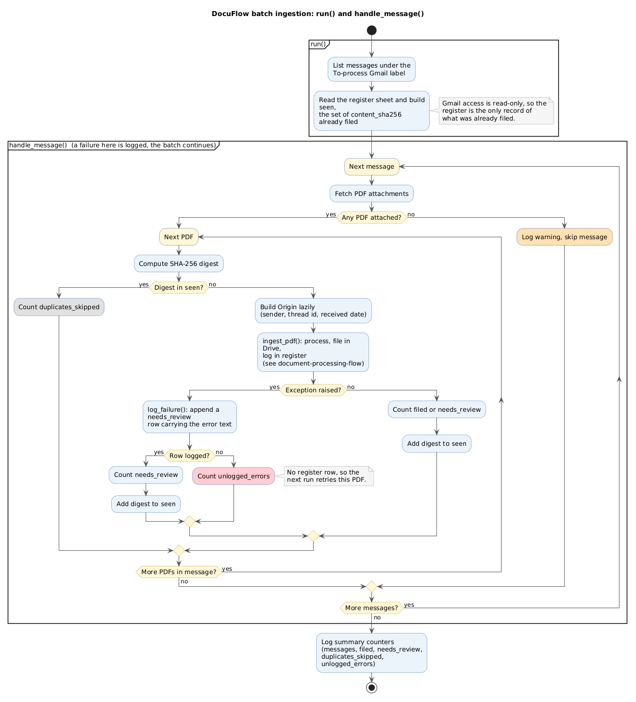

# DocuFlow batch ingestion: run() and handle_message()

Source: [batch-ingestion-flow.puml](./batch-ingestion-flow.puml) · [SVG](./batch-ingestion-flow.svg)

## What it shows
The outer loop of `pipeline.py`: list the messages under the To-process label, load the SHA-256 digests already in the register, then for each PDF attachment skip duplicates or hand it to `ingest_pdf()`. It also shows how failures are contained: a crash on one PDF is logged as `needs_review`, and a crash on one message is logged and the batch continues.

## Why an activity diagram
The flow is mostly nested loops and decisions with counters on each outcome. Activity diagrams show that directly. A sequence diagram would hide the loops, and a flowchart has no partitions for grouping by function.

## Design decisions
- Partitions match the functions `run()` and `handle_message()`.
- `ingest_pdf()` is one box here. Its internals are in [document-processing-flow.md](./document-processing-flow.md).
- Colour: grey is a skipped duplicate, orange a skipped message, red the one outcome that leaves no register row (`unlogged_errors`, retried next run).

## Assumptions
- The diagram follows the code as of the current working tree, which has uncommitted changes to `pipeline.py`.
- It is about 1300px wide because of the two nested loops. Zoom the SVG if it is too small to read.
