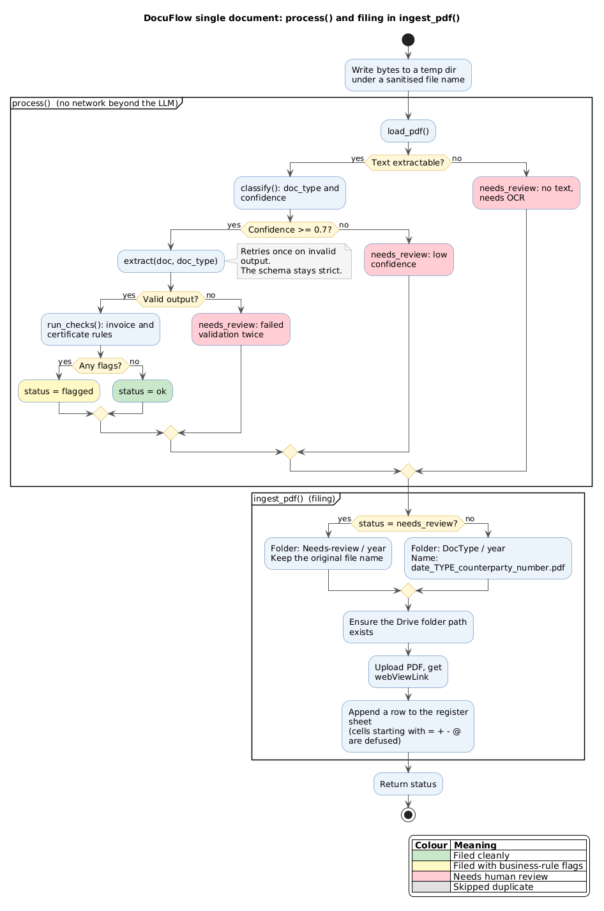

# DocuFlow single document: process() and filing in ingest_pdf()

Source: [document-processing-flow.puml](./document-processing-flow.puml) · [SVG](./document-processing-flow.svg)

## What it shows
What happens to one PDF: load, classify, extract and check inside `process()`, then folder choice, Drive upload and register row inside `ingest_pdf()`. Three early exits (no text, low confidence, invalid output) each produce `needs_review`. A document that passes every step ends as `ok`, or `flagged` if business rules fire.

## Why an activity diagram
The logic is a chain of gates with distinct outcomes, which an activity diagram shows as branches and merges. The result colours also double as a legend.

## Design decisions
- Two partitions: `process()` has no network beyond the LLM, while `ingest_pdf()` does the Drive and Sheets writes.
- Green is ok, yellow is flagged, red is needs_review.
- Confidence threshold 0.7 comes from `REVIEW_THRESHOLD`.

## Assumptions
- The retry-once behaviour of `extract()` is taken from the comment in `pipeline.py`; `extract.py` was not opened.
